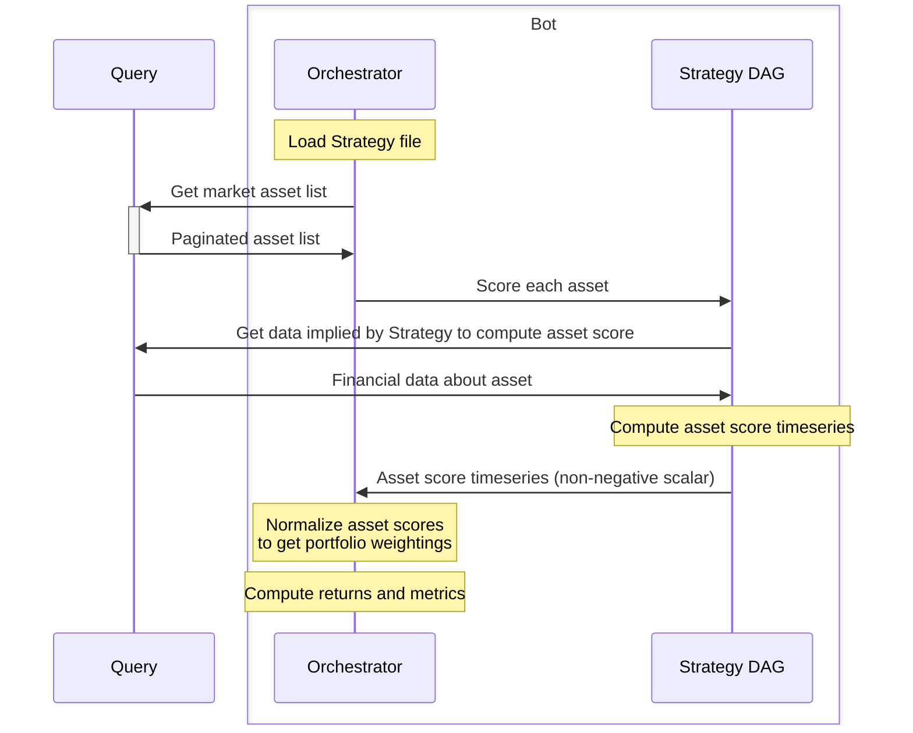

# Luckless

Luckless is a simple extensible algorithmic trading platform for individual investors.  It consists of 2 services (written in **Go** and **Rust**): **Query** serves market data over **grpc**/**Protobuf**, and **Bot** scores a strategy and runs back-tests.

## Features

- [Declarative Asset Allocation](#strategy-dsl): define stock picking strategy with extensible yaml
- [Back-test Runtime](#back-test-runtime): execute strategy against historic data

## Strategy DSL
  
Declarative yaml-base domain specific language is used to specify a asset scoring algorithm as a directed acyclic graph where each graph vertex is a calculation whose input(s) and output are graph edges.

Example [Strategy file](https://github.com/luckless-finance/bot/blob/develop/strategy.yaml)

## Back-test Runtime

The Orchestrator is part of Bot (the `luckless` crate). It loads the Strategy file, scores every Asset, turns the scores into daily portfolio weights and computes the returns itself; there is no separate Broker service. Bot reads market data from mock data (default), CSV files, or the Query service (`--grpc`, experimental).

1. Orchestrator loads Strategy file
2. Orchestrator gets the list of Assets from the data source (the Query service when run with `--grpc`)
3. For each Asset, Orchestrator runs the Strategy directed acyclic graph (DAG)
   1. Bot requests Time Series from the data source as specified in Strategy
   2. Bot computes Asset Score Time Series
4. Orchestrator aggregates Asset Scores over Assets for each day to get allocation Time Series, then computes returns and metrics

## Services

- [*Bot*](https://github.com/luckless-finance/bot) (Rust)
  - Orchestrator: parses a Strategy yaml, scores each Asset and aggregates Asset Scores to get Asset allocations
  - executes Strategy to determine non-negative Asset Score
  - runs back-tests and computes returns and metrics
  - consumes market data from mock data, CSV files or the Query service (GRPC/Protobuf)
- [*Query*](https://github.com/luckless-finance/query) (Golang)
  - written in Go
  - implements GRPC-based query.proto service
  - serves market data from daily-bar CSV files, or generated mock data

> [shared resources](https://github.com/luckless-finance/shared)  |  [docs](https://github.com/luckless-finance/docs)

## Future Work

- Real World Deployment: (long term) automate trade ordering of the real world portfolio

## Abandoned Attempts

- [pyyafa (python)](https://github.com/grahamcrowell/pyyafa) 
- [yafa-bot-archived (java)](https://github.com/grahamcrowell/yafa-bot-archived)
